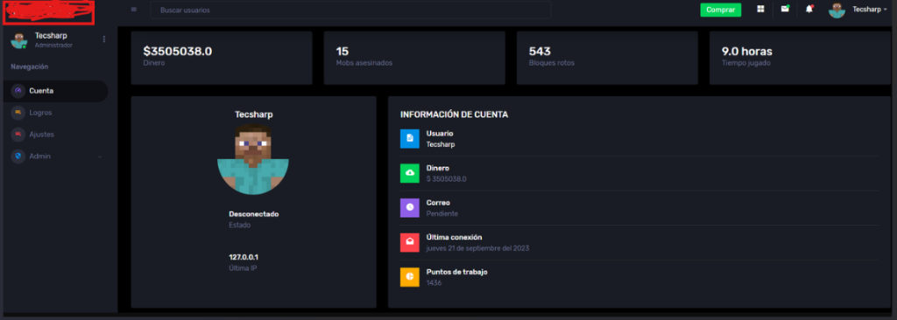
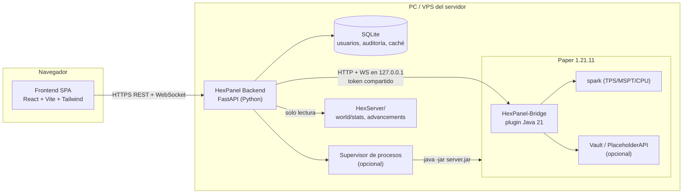
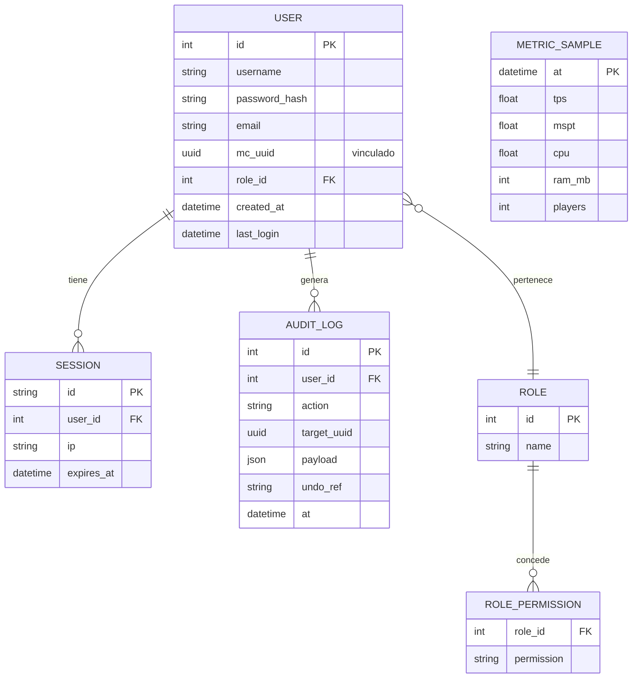

# HexPanel — Plan de desarrollo

> Panel web de administración para el servidor Minecraft de HexLauncher (Paper 1.21.11, Java 21).
> Es un proyecto **independiente del launcher**: tiene su propio backend, frontend y plugin para el servidor.
> Ahora vive dentro de `HexPanel/` y se puede mover a su propio repositorio en cualquier momento.

---

## 1. Objetivos

| # | Objetivo | Prioridad |
|---|----------|-----------|
| O1 | Portal de cuenta del jugador (estadísticas, información de la cuenta, logros), con el estilo de la imagen de referencia | Alta |
| O2 | **Ver el inventario y el cofre de ender de cualquier jugador de forma gráfica** (como el juego) | Alta |
| O3 | **Editar el inventario y el cofre de ender con drag & drop** (mover, apilar, dividir, borrar, dar ítems), con jugadores conectados y desconectados | Alta |
| O4 | Sección **Estado del servidor** al estilo Pterodactyl: CPU, RAM, TPS, MSPT, jugadores, consola en vivo y botones de encendido | Alta |
| O5 | Herramientas de admin: buscar jugadores, kick/ban/whitelist/op, registro de auditoría con opción de deshacer | Media |
| O6 | Fuera de alcance por ahora: varios servidores, gestor de archivos, tienda ("Comprar") | — |

---

## 2. Referencia de diseño



### Elementos que hay que reproducir
- **Sidebar izquierda** (≈240 px): logo arriba, tarjeta del usuario (cabeza del skin, nombre, rol), menú *Navegación*: `Cuenta`, `Logros`, `Ajustes`, `Admin ▸` (se despliega y solo aparece con el permiso correspondiente).
- **Topbar**: botón para colapsar la sidebar (☰), buscador de usuarios, botón principal verde, iconos (apps, mensajes, notificaciones con badge) y menú del usuario con avatar.
- **Fila de 4 KPI cards**: valor grande en negrita + etiqueta gris (Dinero, Mobs asesinados, Bloques rotos, Tiempo jugado).
- **Tarjeta de perfil**: nombre, busto del skin dentro de un círculo, Estado (Conectado/Desconectado), Última IP.
- **Tarjeta "Información de cuenta"**: lista de filas con un icono cuadrado de color (azul, verde, morado, rojo, amarillo), título en negrita y valor en gris, separadas por divisores.

### Tokens de diseño (aproximados a partir de la imagen)
```css
--bg-app:      #16181d;   /* fondo general */
--bg-sidebar:  #1b1e24;
--bg-card:     #22252c;
--bg-hover:    #2a2e36;
--border:      #2c3038;
--text:        #e8eaed;
--text-muted:  #8b919c;
--accent:      #22c55e;   /* botón verde "Comprar" / acciones principales */
--chip-blue:   #3b82f6;  --chip-green: #22c55e;  --chip-purple: #8b5cf6;
--chip-red:    #ef4444;  --chip-yellow: #f59e0b;
--radius-card: 6px;
font-family: "Poppins", "Inter", system-ui;   /* para los slots/tooltips: "Minecraft" (fuente bitmap) */
```

---

## 3. Arquitectura



### Por qué un plugin "Bridge" y no solo RCON
RCON solo manda comandos y devuelve texto. **No puede leer ni modificar inventarios con fidelidad** (encantamientos, nombres, componentes de datos de 1.21), no transmite la consola en tiempo real y no entrega TPS. El plugin usa la API de Paper directamente, sobre el hilo principal, sin perder información de los ítems.

> [!NOTE]
> Paper 1.21.9+ incluye el *Server Management Protocol* (`management-server-*` en `server.properties`, JSON-RPC por WebSocket). Cubre whitelist, bans, ops y jugadores, pero **no inventarios ni TPS**. Se descarta como canal principal y se deja como mejora opcional.

### Quién arranca el servidor (decisión abierta, ver §13)
Hoy el launcher (`server_manager.py`) lanza `server.jar` y `playit.exe` como procesos hijos. HexPanel admite dos modos:
- **Modo Conectado (MVP)**: el servidor lo arranca quien sea (launcher o un script). El panel se conecta al Bridge. Puede **detener** y **reiniciar** el servidor (vía Bridge), pero no encenderlo si está apagado.
- **Modo Supervisor (Fase 6)**: el backend de HexPanel lanza y vigila el proceso Java, así que puede encender, apagar, reiniciar automáticamente si se cae y leer el uso de CPU y RAM del proceso con `psutil`. Usa un lockfile `HexServer/.hexpanel.lock` para no arrancar el servidor dos veces si el launcher ya lo hizo.

---

## 4. Stack tecnológico

| Capa | Tecnología | Motivo |
|------|-----------|--------|
| Frontend | **React 19 + TypeScript + Vite** | Ecosistema maduro y buena integración con DnD |
| Estilos | **Tailwind CSS v4** + variables CSS (tokens §2) | Permite replicar rápido el diseño oscuro |
| Drag & drop | **@dnd-kit/core** | Accesible, soporta sensores de puntero y teclado, overlays personalizados |
| Estado / datos | **TanStack Query** (REST) + **Zustand** (estado de UI y WS) | Caché e invalidación sencillas |
| Router | React Router 7 | — |
| Gráficas | **Recharts** | CPU, RAM, TPS en el tiempo |
| Consola | **xterm.js** | Colores ANSI, scroll y rendimiento con miles de líneas |
| Skins | `skinview3d` (vista 3D opcional) + render de la cabeza en canvas | — |
| Iconos UI | lucide-react | — |
| Backend | **Python 3.12+ / FastAPI / Uvicorn** | Mismo lenguaje que el launcher; async nativo y WebSockets |
| ORM / DB | **SQLModel + SQLite** (con Alembic) | Sin servidor externo; se puede migrar a Postgres |
| HTTP al Bridge | `httpx` (async) + `websockets` | — |
| Seguridad | `argon2-cffi`, sesiones en cookie httpOnly, `slowapi` (rate limit) | — |
| Plugin | **Java 21, Paper API 1.21.11, Gradle (Kotlin DSL), paperweight-userdev** | NMS solo para cargar inventarios de jugadores offline |
| Servidor HTTP del plugin | **Javalin 6** (sombreado con shadow) | REST y WS ligeros dentro del plugin |
| Assets | Script Python + Pillow | Extrae y renderiza los iconos de los ítems desde el `.jar` del cliente |

---

## 5. Estructura del repositorio

```
HexPanel/
├── PLAN.md
├── docs/
│   ├── referencia-diseno.png
│   └── bridge-protocol.md          # contrato Backend ⇄ Bridge
├── bridge-plugin/                   # Plugin Paper (Java 21)
│   ├── build.gradle.kts
│   └── src/main/java/dev/hex/panel/bridge/
│       ├── HexPanelBridge.java      # onEnable/onDisable, config, token
│       ├── http/                    # Javalin: rutas REST, WS, auth por token
│       ├── inventory/
│       │   ├── ItemCodec.java       # ItemStack → DTO visual (+ hash)
│       │   ├── InventoryService.java# leer y aplicar operaciones (hilo principal)
│       │   ├── OfflinePlayerData.java # carga y guardado offline vía NMS (estilo OpenInv)
│       │   ├── EditLockManager.java # bloquea el login mientras se edita offline
│       │   └── WatchTask.java       # detecta cambios y emite diffs por WS
│       ├── console/ConsoleAppender.java  # Log4j appender → WS
│       ├── stats/StatsService.java  # estadísticas, spark, Vault/PAPI
│       └── auth/LinkCommand.java    # /panel link → código de vinculación
├── backend/
│   ├── pyproject.toml
│   └── app/
│       ├── main.py
│       ├── core/{config.py, security.py, permissions.py}
│       ├── db/{models.py, session.py, migrations/}
│       ├── bridge/{client.py, events.py}     # cliente HTTP y WS hacia el plugin
│       ├── services/{players.py, inventory.py, stats.py, server.py, audit.py, supervisor.py}
│       ├── api/{auth.py, me.py, players.py, inventory.py, server.py, admin.py}
│       └── ws/{hub.py, console.py, server_stats.py, inventory.py}
├── frontend/
│   ├── package.json
│   ├── public/assets/items/        # ⚠️ generado por tools/, NO se commitea
│   └── src/
│       ├── layout/{Sidebar.tsx, Topbar.tsx, AppShell.tsx}
│       ├── components/ui/{Card.tsx, KpiCard.tsx, InfoRow.tsx, Badge.tsx}
│       ├── components/inventory/
│       │   ├── PlayerInventory.tsx  # 4×9 + hotbar + armadura + mano secundaria
│       │   ├── EnderChest.tsx       # 3×9
│       │   ├── Slot.tsx             # droppable + draggable
│       │   ├── ItemIcon.tsx         # icono, cantidad, barra de durabilidad, brillo de encantamiento
│       │   ├── ItemTooltip.tsx      # tooltip estilo Minecraft
│       │   ├── ItemCatalog.tsx      # buscador para "dar ítem"
│       │   └── TrashZone.tsx
│       ├── pages/{Account, Achievements, Settings}.tsx
│       ├── pages/admin/{ServerStatus, Players, PlayerDetail, Audit}.tsx
│       ├── api/  stores/  hooks/
│       └── styles/tokens.css
└── tools/
    └── extract_assets.py            # genera los iconos desde el client jar
```

---

## 6. Plugin HexPanel-Bridge

### 6.1 Responsabilidades
1. Servidor HTTP/WS **solo en `127.0.0.1:8765`** (configurable) con `Authorization: Bearer <token>`. El token se genera en el primer arranque en `plugins/HexPanelBridge/config.yml`.
2. Inventarios y cofre de ender: lectura, operaciones y diffs en vivo.
3. Consola: un appender de Log4j reenvía cada línea por WS. Los comandos se ejecutan con `Bukkit.dispatchCommand(console, cmd)` en el hilo principal.
4. Métricas: TPS y MSPT (API de spark si está instalado, si no `Bukkit.getTPS()` / `getAverageTickTime()`), jugadores online, memoria de la JVM, tamaño de los mundos.
5. Jugadores: lista, estado online, última IP y última conexión (`PlayerJoinEvent` se guarda en `data.yml`/SQLite del plugin), estadísticas.
6. Integraciones opcionales (`softdepend`): **Vault** (dinero), **PlaceholderAPI** (cards configurables, por ejemplo "Puntos de trabajo" con `%jobsr_user_points%`).
7. Vinculación de cuentas: `/panel link` genera un código de 6 caracteres válido 10 min (§9).

### 6.2 Contrato (resumen; el detalle va en `docs/bridge-protocol.md`)
```
GET  /v1/health                         → { version, mcVersion, uptime }
GET  /v1/metrics                        → { tps[1m,5m,15m], mspt, players, heap, worlds }
GET  /v1/players?query=&online=         → [{ uuid, name, online, lastSeen, lastIp }]
GET  /v1/players/{uuid}/stats           → { mobKills, blocksMined, playTimeTicks, deaths, money?, custom{} }
GET  /v1/players/{uuid}/containers      → { inventory: Container, enderchest: Container }
POST /v1/players/{uuid}/containers/ops  → aplica una lista de operaciones (atómica)
POST /v1/commands                       → { command } → { ok }
POST /v1/server/stop | /restart
WS   /v1/stream                         → eventos: console.line, metrics.tick, player.join/quit,
                                          container.diff, container.locked
```

---

## 7. Inventario gráfico y drag & drop (núcleo del proyecto)

### 7.1 Modelo de slots (índices de Bukkit, independientes del formato NBT)

```
PlayerInventory (41 slots)                    EnderChest (27 slots)
┌────┬────────────────────────────────┐       ┌──────────────────────────┐
│ 39 │ casco                          │       │  0  1  2  3  4  5  6  7  8│
│ 38 │ peto        [ cabeza/skin ]    │       │  9 ...               17   │
│ 37 │ grebas                         │       │ 18 ...               26   │
│ 36 │ botas                    [40]  │ ← mano secundaria
├────┴────────────────────────────────┤       └──────────────────────────┘
│  9 10 11 12 13 14 15 16 17          │  inventario principal
│ 18 ...                    26        │
│ 27 ...                    35        │
├─────────────────────────────────────┤
│  0  1  2  3  4  5  6  7  8          │  hotbar
└─────────────────────────────────────┘
```

Los slots de armadura solo aceptan ítems válidos para esa parte (casco/calabaza/cabezas en 39, etc.). La validación se hace **en el plugin**; el frontend solo la anticipa para mostrar el slot en rojo.

### 7.2 DTO de un ítem (lo que recibe el frontend)
```jsonc
{
  "slot": 0,
  "id": "minecraft:diamond_sword",
  "count": 1,
  "maxStack": 1,
  "hash": "a91f…",                 // hash de todos los componentes: identifica el ítem exacto
  "name": { "text": "Excalibur", "color": "gold", "italic": false }, // componente JSON de Adventure
  "lore": [ /* componentes */ ],
  "enchantments": [{ "id": "minecraft:sharpness", "level": 5 }],
  "damage": 120, "maxDamage": 1561,
  "glint": true,
  "dyeColor": null, "potionColor": null, "headTexture": null
}
```
Container: `{ "type": "inventory" | "enderchest", "revision": 42, "online": true, "items": [ItemDTO…] }`

> [!IMPORTANT]
> El frontend **nunca envía ítems serializados**. Solo manda operaciones (mover el slot A al B). El plugin conserva el `ItemStack` original, así que encantamientos, nombres, componentes personalizados y datos de otros plugins se conservan al 100%.

### 7.3 Operaciones
```jsonc
POST /containers/ops
{
  "baseRevision": { "inventory": 42, "enderchest": 7 },
  "ops": [
    { "op": "move",   "from": {"c":"inventory","slot":3}, "to": {"c":"enderchest","slot":10},
      "count": null, "expectHash": "a91f…" },          // null = todo el stack
    { "op": "split",  "from": {...}, "to": {...}, "count": 32, "expectHash": "…" },
    { "op": "delete", "from": {...}, "expectHash": "…" },
    { "op": "give",   "to": {...}, "item": "minecraft:diamond_sword[enchantments={sharpness:5}]", "count": 1 },
    { "op": "edit",   "at": {...}, "count": 16, "name": "…", "enchantments": [...] }   // Fase 5
  ]
}
```
Qué pasa al soltar un ítem (igual que en el juego):

| Destino | Resultado |
|---------|-----------|
| Vacío | Mueve (todo el stack, o la cantidad indicada) |
| Mismo ítem (mismo `hash`) y apilable | Junta hasta `maxStack`; lo que sobra se queda en el origen |
| Ítem distinto | Intercambia los dos |
| Papelera | Borra (pide confirmación si es valioso: encantado o con nombre) |

Gestos en la UI:
- **Arrastrar**: mover el stack completo.
- **Shift + arrastrar** o **clic derecho**: dividir a la mitad. Un modal con un slider permite elegir otra cantidad.
- **Ctrl + clic**: borrar.
- **Doble clic**: abre el editor del ítem (Fase 5).
- **Arrastrar desde el catálogo**: dar un ítem.
- Funciona con teclado (sensor de teclado de dnd-kit) para accesibilidad.

### 7.4 Concurrencia y tiempo real
1. Cada contenedor tiene una `revision` que el plugin incrementa con cada cambio.
2. Mientras al menos un admin esté viendo a un jugador, el `WatchTask` (cada 4 ticks, ≈200 ms) compara un hash del contenido. Si cambió, emite `container.diff { slots cambiados, revision }` por WS. Esto cubre todo lo que puede modificar un inventario (recoger, craftear, comer, otros plugins) sin escuchar decenas de eventos.
3. Al aplicar operaciones, el plugin verifica `expectHash` en cada slot origen. Si no coincide, **rechaza todo el lote** (`409 Conflict`) y devuelve el estado actual. El frontend hace un rollback animado y avisa: *"El jugador movió ese ítem"*.
4. **UI optimista**: el ítem se mueve al soltarlo; se confirma o se revierte con la respuesta.
5. Si el jugador tiene el inventario abierto en el juego, el cambio se aplica igual y se llama a `player.updateInventory()`.

### 7.5 Jugadores offline
- Paper no ofrece una API para editar el inventario de un jugador desconectado. El plugin carga sus datos con NMS (**paperweight-userdev**): crea un `ServerPlayer` temporal y lee y escribe `world/playerdata/<uuid>.dat` usando el propio guardado del servidor, igual que hace el plugin **OpenInv**. Así se respetan los formatos de 1.21.5+ (la armadura y la mano secundaria pasaron al compuesto `equipment`) y los componentes de datos.
- **EditLockManager**: mientras un admin edita a un jugador offline, `AsyncPlayerPreLoginEvent` retrasa el login unos segundos (o lo rechaza con "Tu inventario está siendo editado, intenta en unos segundos"). Así se evita que una edición pise los datos del jugador o se pierda.
- Al conectarse un jugador que se estaba viendo offline, la vista cambia sola a modo online.
- Recordatorio: el servidor está en `online-mode=false`, así que los UUID son *offline UUIDs* (`MD5("OfflinePlayer:" + nombre)`). El plugin siempre resuelve nombre ⇄ UUID con `Bukkit.getOfflinePlayer`/`usercache.json`, nunca contra Mojang.

> [!WARNING]
> El código NMS se rompe con cada versión de Minecraft. Hay que aislarlo en `OfflinePlayerData` detrás de una interfaz. Si la versión no es compatible, el plugin desactiva la **edición offline** (la lectura sigue funcionando con un lector NBT de solo lectura) y lo indica en `/v1/health`.

### 7.6 Iconos de los ítems (`tools/extract_assets.py`)
- Los assets de Minecraft son de Mojang y **no se redistribuyen**. El script los genera localmente desde el `.jar` del cliente de la misma versión (1.21.11), que el launcher ya tiene descargado. La salida va a `frontend/public/assets/items/` y se agrega al `.gitignore`.
- Pasos:
  1. Leer `assets/minecraft/items/*.json` (definiciones de modelo de ítem, 1.21.4+) y resolver la herencia de `models/item|block/*.json`.
  2. **Ítems planos** (`item/generated`, `item/handheld`): componer `layer0..n` en 16×16 y escalar ×2 con *nearest neighbor*.
  3. **Bloques cúbicos** (`cube_all`, `cube_column`, `cube_bottom_top`, `orientable`…): render isométrico con Pillow (cara superior, izquierda y derecha con sombreado 100%/80%/60%).
  4. **Bloques no cúbicos** (escaleras, losas, vallas, cofres…): Fase 1 usa su textura de ítem si existe o una aproximación; mejora futura: pre-renderizar con [deepslate](https://github.com/misode/deepslate) (WebGL) en un paso de build con Node.
  5. Texturas animadas (`.mcmeta`): se usa el primer frame.
  6. Generar `items.json` con `{ id, name (desde lang/es_es.json), maxStack, category }` para el catálogo y el buscador.
- Detalles en el frontend: brillo de encantamiento con CSS (`mask` + gradiente animado), barra de durabilidad (verde → rojo), número de cantidad con la fuente Minecraft y sombra, tinte para cuero, pociones y flechas con efecto.

---

## 8. Páginas y secciones

| Ruta | Sección | Contenido | Permiso |
|------|---------|-----------|---------|
| `/cuenta` | **Cuenta** (imagen de referencia) | KPI: Dinero*, Mobs asesinados, Bloques rotos, Tiempo jugado · Perfil: skin, estado, última IP · Información: usuario, dinero, correo, última conexión, puntos de trabajo* | jugador |
| `/cuenta/inventario` | Mi inventario | Inventario y cofre de ender propios (solo lectura) | jugador |
| `/logros` | **Logros** | Árbol o cuadrícula de advancements (`world/advancements/<uuid>.json`), progreso por categoría | jugador |
| `/ajustes` | **Ajustes** | Contraseña, correo, sesiones activas, desvincular cuenta | jugador |
| `/admin/servidor` | **Estado del servidor** (estilo Pterodactyl) | Badge Online/Offline/Iniciando, uptime, gráficas CPU/RAM/TPS/MSPT (últimos 10 min), jugadores online, consola xterm con input y historial (↑/↓), botones Iniciar/Detener/Reiniciar/Matar, dirección de Playit | `server.view`, `server.console`, `server.power` |
| `/admin/jugadores` | Jugadores | Tabla con búsqueda, filtros (online, baneado, op), acciones rápidas | `players.view` |
| `/admin/jugadores/:name` | Detalle del jugador | Igual que `/cuenta` + pestañas **Inventario** y **Cofre de ender** lado a lado con DnD entre ambos, catálogo de ítems y papelera; acciones kick, ban, op, whitelist, teletransportar | `inventory.view`, `inventory.edit`, `players.moderate` |
| `/admin/auditoria` | Auditoría | Quién hizo qué y cuándo (ops de inventario, comandos, power), con diff antes/después y botón **Deshacer** | `audit.view` |
| `/admin/usuarios` | Usuarios del panel | Roles y permisos | `panel.admin` |

\* Cards opcionales: aparecen solo si hay plugin de economía (Vault + EssentialsX, etc.) o un placeholder configurado. **Hoy el servidor solo tiene spark instalado**, así que *Dinero* y *Puntos de trabajo* van ocultas hasta que se agregue una economía.

Origen de cada dato:
- Mobs asesinados → `Statistic.MOB_KILLS`
- Tiempo jugado → `Statistic.PLAY_ONE_MINUTE` / 72 000 = horas
- Bloques rotos → suma de `minecraft:mined` en `world/stats/<uuid>.json`. Lo calcula el backend en solo lectura y lo cachea 60 s, porque sumar `MINE_BLOCK` de todos los materiales en el plugin sale caro.
- Última conexión e IP → registro propio del Bridge en cada join
- Skin → como el servidor es offline, se usa la textura del `PlayerProfile` si existe (por ejemplo con SkinsRestorer); si no, Steve o Alex según el UUID

La topbar mantiene el buscador global de usuarios (autocompletado, abre el detalle del jugador). El botón verde se reutiliza como acción principal de la página actual (por ejemplo "Guardar" o "Dar ítem"), ya que la tienda queda fuera de alcance.

---

## 9. Autenticación, roles y seguridad

- **Vinculación de cuenta** (necesaria porque `online-mode=false` no da identidad verificable):
  1. El jugador escribe `/panel link` en el juego y el Bridge genera el código `K7Q2XM` (TTL 10 min, un solo uso) asociado a su UUID.
  2. En la web: *Registrarse* → nombre + código + contraseña. Se crea el usuario vinculado al UUID.
  3. Para recuperar la contraseña se repite el flujo con `/panel reset`.
- **Primer admin**: `python -m app.cli create-admin <usuario>` (o `HEXPANEL_ADMIN_*` en el primer arranque).
- **Roles**: `player`, `moderator`, `admin` + permisos granulares (§8). Se comprueban siempre en el backend; el frontend solo oculta la UI.
- **Sesiones**: cookie `httpOnly`, `Secure`, `SameSite=Lax`, rotación al hacer login; token CSRF en las mutaciones; contraseñas con argon2id; rate limit en login, registro y vinculación (5/min por IP).
- **Bridge**: escucha solo en `127.0.0.1`, token de 256 bits y comparación en tiempo constante. El backend nunca expone el token al navegador.
- **Auditoría** obligatoria para `inventory.edit`, `server.console`, `server.power` y moderación: actor, IP, objetivo, payload, estado antes/después (los `ItemStack` serializados se guardan en el lado del Bridge para poder deshacer).
- **Exponer a Internet**: detrás de un reverse proxy con HTTPS (Caddy) o un túnel (Cloudflare Tunnel). Nunca exponer el puerto del Bridge ni RCON.
- **Comandos peligrosos**: se puede configurar una lista de comandos que requieren confirmación o el rol admin (`stop`, `op`, `deop`, `ban-ip`…).

---

## 10. Modelo de datos (backend, SQLite)


`METRIC_SAMPLE`: una muestra cada 5 s, se conservan 24 h, para las gráficas de la sección de estado.

---

## 11. API del backend (para el frontend)

```
POST   /api/auth/login | /logout | /register | /link/verify
GET    /api/me                               → usuario + permisos
GET    /api/me/overview                      → KPIs + info de cuenta (página Cuenta)
GET    /api/me/achievements
GET    /api/players?q=&online=&page=
GET    /api/players/{name}/overview
GET    /api/players/{name}/containers
POST   /api/players/{name}/containers/ops    → reenvía al Bridge + auditoría
POST   /api/players/{name}/actions           → kick | ban | op | whitelist | tp
GET    /api/server/status                    → estado + métricas actuales
GET    /api/server/metrics?range=10m
POST   /api/server/power                     → start | stop | restart | kill
POST   /api/server/command
GET    /api/items                            → catálogo (desde items.json)
GET    /api/audit?…  POST /api/audit/{id}/undo

WS     /ws  (multiplexado por tema)
       subscribe: "console" | "metrics" | "players" | "container:{uuid}"
```
El backend actúa como **hub**: mantiene una sola conexión WS con el Bridge y reparte los eventos a los navegadores suscritos, filtrando por permisos (un jugador solo recibe `container:{su_uuid}`).

---

## 12. Hoja de ruta

### Fase 0 — Fundaciones (≈2 días)
- [ ] Monorepo `HexPanel/` con `backend/`, `frontend/`, `bridge-plugin/`, `tools/`
- [ ] Linters y formato: ruff + mypy (backend), ESLint + Prettier (frontend), Spotless (plugin)
- [ ] CI en GitHub Actions: tests de los 3 proyectos + build del `.jar`
- [ ] `docs/bridge-protocol.md` con el contrato v1

### Fase 1 — Bridge mínimo + Estado del servidor (≈4 días)
- [ ] Plugin: config + token, Javalin en 127.0.0.1, `/health`, `/metrics`, `/players`, `/commands`
- [ ] Plugin: `ConsoleAppender` → WS `console.line`
- [ ] Backend: cliente del Bridge con reconexión exponencial, hub WS, muestreo de métricas
- [ ] Frontend: AppShell (sidebar + topbar, tokens §2), página **Estado del servidor** con gráficas, consola xterm y lista de jugadores
- ✅ *Criterio*: desde el navegador se ven TPS y consola en vivo y se puede ejecutar `say hola`

### Fase 2 — Autenticación y página Cuenta (≈4 días)
- [ ] Usuarios, roles, sesiones, CLI `create-admin`
- [ ] `/panel link` + flujo de registro
- [ ] Estadísticas (Bridge + lectura de `world/stats`), último login e IP
- [ ] Página **Cuenta** fiel a la referencia (KPI cards, perfil, información de cuenta), buscador de usuarios
- ✅ *Criterio*: un jugador vincula su cuenta y ve sus estadísticas reales

### Fase 3 — Inventario de solo lectura (≈4 días)
- [ ] `tools/extract_assets.py` (ítems planos + bloques cúbicos + `items.json`)
- [ ] Bridge: `ItemCodec`, `GET /containers` para jugadores online y offline (lectura)
- [ ] Frontend: `PlayerInventory`, `EnderChest`, `ItemIcon`, `ItemTooltip` con colores y formato de Minecraft
- [ ] `WatchTask` + `container.diff` en vivo
- ✅ *Criterio*: el inventario y el cofre de ender se ven idénticos al juego y se actualizan en vivo

### Fase 4 — Drag & drop y edición (≈6 días)
- [ ] Bridge: `POST /containers/ops` (move, split, delete, give) atómico en el hilo principal, validación de armadura y `expectHash`
- [ ] Edición offline vía NMS + `EditLockManager`
- [ ] Frontend: dnd-kit (sensores de puntero y teclado), `DragOverlay` con el icono, UI optimista + rollback, catálogo de ítems, papelera, modal de división
- [ ] Auditoría de cada operación + **Deshacer**
- ✅ *Criterio*: mover ítems entre inventario y cofre de ender de un jugador conectado y de uno desconectado, sin pérdida ni duplicación (tests §14)

### Fase 5 — Admin y pulido (≈4 días)
- [ ] Acciones de moderación, página de auditoría, gestión de usuarios y roles
- [ ] Página **Logros**
- [ ] Editor de ítems (cantidad, nombre, encantamientos)
- [ ] Integración opcional con Vault/PlaceholderAPI y cards configurables
- [ ] Responsive (sidebar colapsable en móvil), i18n es/en

### Fase 6 — Modo Supervisor y despliegue (≈3 días)
- [ ] `services/supervisor.py`: arranque y parada de Java y Playit, auto-restart, CPU y RAM del proceso con psutil, lockfile compartido con el launcher
- [ ] Empaquetado: el backend sirve el frontend compilado; ejecutable con PyInstaller o servicio de Windows (NSSM)
- [ ] Guía de exposición con HTTPS (Caddy o Cloudflare Tunnel)

**Total estimado: ≈4–5 semanas** de trabajo de una persona.

---

## 13. Decisiones abiertas

| # | Pregunta | Recomendación |
|---|----------|---------------|
| D1 | ¿El panel arranca el servidor (Supervisor) o sigue haciéndolo el launcher? | MVP en Modo Conectado; Supervisor en Fase 6 |
| D2 | ¿Los jugadores normales tienen acceso al panel o solo los admins? | Sí: la referencia es un portal de jugador con sección Admin |
| D3 | ¿Qué plugin de economía usar para la card "Dinero"? | EssentialsX + Vault (estándar); o card oculta |
| D4 | ¿"Puntos de trabajo" viene de Jobs Reborn? | Card configurable vía PlaceholderAPI |
| D5 | ¿El panel será accesible desde Internet o solo en LAN? | Define la prioridad de HTTPS y del túnel |
| D6 | Nombre del paquete Java (`dev.hex.panel`) y puerto del Bridge (`8765`) | Confirmar |

---

## 14. Estrategia de pruebas

- **Plugin**: JUnit 5 + **MockBukkit** para `ItemCodec` y la lógica de operaciones (merge, swap, split, validación de armadura, `expectHash`). Tests de integración con un Paper real en CI (`run-paper` de Gradle) para la edición offline.
- **Propiedades críticas** (tests de invariantes): después de cualquier secuencia aleatoria de operaciones, **la suma de cada tipo de ítem se conserva** (salvo delete/give) y ningún `hash` cambia → nada se duplica ni se pierde.
- **Backend**: pytest + httpx con un Bridge falso; permisos (un jugador no puede leer el inventario de otro), rate limit y auditoría.
- **Frontend**: Vitest + Testing Library para la lógica del drop; **Playwright** E2E para arrastrar entre inventario y cofre de ender, conflicto 409 y rollback.
- **Manual**: editar a un jugador mientras juega (recogiendo ítems y crafteando) y comprobar que no se duplica nada.
